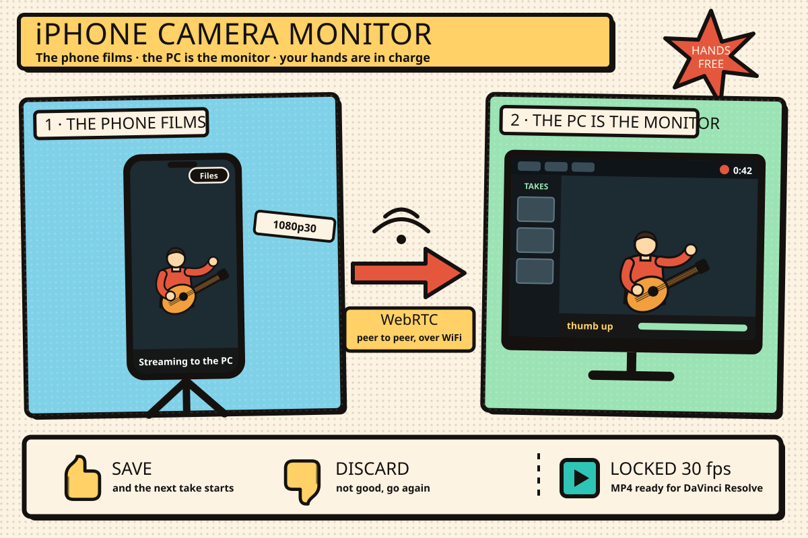

# iPhone Camera Monitor



<sub>The cover is `docs/portada.svg` (vector, hand-edited). There is a 2x PNG at
`docs/portada.png` for viewers that don't render SVG.</sub>

Live monitor of the iPhone's rear camera on a Windows screen, with recording on
the PC controlled by hand gestures. Same local network, no native apps, no
Xcode.

Built for filming yourself playing an instrument: the phone sits on a tripod,
the PC screen shows exactly what the camera sees, and you save or discard takes
with a thumb — you never touch the phone during the session.

The iPhone opens a page served by the PC in Safari, grabs the camera with
`getUserMedia` and sends the video over **WebRTC** straight to the PC. The Node
server only does *signaling* (exchanges SDP and ICE). **The video never goes
through the server**: it is peer-to-peer.

## Features

- **Live monitor** of the iPhone's rear camera at 1080p30 over the LAN.
- **Hands-free takes**: recording runs continuously; thumb up saves the take
  and starts the next one, thumb down throws it away and starts over. Gesture
  recognition runs on the PC with MediaPipe.
- **Takes gallery** on the monitor, with a trash folder instead of deleting.
- **Recording on the PC**, written to disk as it streams in, never held in
  memory.
- **Editor-ready files**: every take is converted to a regular MP4 at a
  **constant 30 fps**, so DaVinci Resolve imports it and it stays in sync.
- **Audio loudness normalization** to -14 LUFS with a peak limiter, without the
  pumping of iOS's automatic gain control.
- **Phone ↔ PC shared folder** for moving large videos across the LAN without
  recompressing them (a local WeTransfer replacement).
- **Auto-reconnect** when Safari is suspended or the WiFi drops, plus a live
  stats panel (resolution, fps, bitrate, codec, loss, jitter).
- **Self-signed HTTPS** generated automatically, covering every LAN IP of the
  PC.

## Getting started

Requirements: Node 18+, [ffmpeg](https://ffmpeg.org/) on the `PATH`, Chrome or
Edge on the PC, and an iPhone on the same network.

```bash
npm install      # also downloads the gesture model (~8 MB)
npm start
```

- **PC** (Chrome/Edge): `https://localhost:3000/monitor.html`
- **iPhone** (Safari, same network): `https://<PC-IP>:3000/phone.html`

The server prints both URLs with the IP already resolved. Tap the iPhone screen
once (Safari requires a user gesture to grant the camera) and the feed shows up
within 1–2 seconds.

## Gestures

You make them **at the phone's camera**, and the PC reads them from the video it
receives. Recording runs on its own while there is video: each thumb closes the
current take and starts the next one, so you never have to say "go".

| gesture | action |
| --- | --- |
| thumb up | save the take and keep recording the next one |
| thumb down | discard the take and start over |

Gestures must be **held for 700 ms**: a hand passing in front of the camera
while playing triggers nothing, and a bar at the bottom left shows the
progress. After firing there is a 1.5 s cooldown.

There used to be an open-palm gesture to restart, and it didn't survive real
use: fingers on the fretboard are four extended fingers, just like an open
palm, so it kept restarting takes by itself. Thumbs don't show up by accident
while playing, and the classifier recognizes them with high, stable
confidence.

The model is MediaPipe's **Gesture Recognizer**, which ships with `Thumb_Up` and
`Thumb_Down` already trained, backed by a geometric check on the 21 hand
landmarks because with a guitar in front of you the classifier sometimes calls
a thumb up "None". Votes are counted over a 1 s window rather than requiring
consecutive frames, since the score oscillates around the threshold.

Keyboard shortcuts on the monitor:

| key | action |
| --- | --- |
| `G` | save the take (same as thumb up) |
| `D` | discard the take (same as thumb down) |
| `P` | pause / resume recording |
| `S` | stats panel |
| `F` or double click | fullscreen |
| `V` | hide / show the takes gallery |
| `H` | hide / show the header |

Deleting a take from the gallery moves it to `grabaciones/.papelera` instead of
destroying it.

**Inference runs on the PC, not on the iPhone**, on purpose: the phone is
already capturing and encoding H.264, and adding inference heats it up and makes
it lower the quality of the very video we want to watch. Also the recording
lives on the PC, so gestures and recording stay on the same side. After 3 s
without a thumb it drops from ~12 inferences per second to one, which keeps the
monitor video smooth.

## Recording

Takes are saved in `grabaciones/`, **on the PC**, as
`toma-2026-09-12_16-04-31.mp4`: H.264 in an MP4 with the index up front and a
**constant frame rate**, which is what DaVinci Resolve and any editor expect
(see below for why it has to be converted).

The `MediaRecorder` chunks are sent over WebSocket as they are produced and the
server writes them to disk in a `.parcial-*` file, which is renamed on save and
deleted on discard. The whole video is never held in memory: a take of several
minutes at 12 Mbps is hundreds of MB. If the tab closes mid-take, the partial
file is cleaned up.

`GET /api/grabaciones` lists what has been saved.

### Why the take is converted when it ends

There are **two** separate problems between what `MediaRecorder` produces and
what an editor accepts. The first showed up as a "corrupted file"; the second,
worse, imports without complaint and drifts out of sync with the audio.

#### 1. The container: fMP4

`MediaRecorder` with `video/mp4;codecs=avc1` **does not write a regular MP4**:
it writes a **fragmented MP4** (fMP4). It has no choice, because it emits the
file in chunks without knowing how long the take will be.

```
fragmented:  ftyp | moov (empty, duration=0) | moof+mdat | moof+mdat | ...
regular:     ftyp | moov (full index)        | mdat
```

In the fragmented file the `moov` has no sample table (`stbl`: stts/stsz/stco):
**there is no index**, and the real duration is spread across every `moof`.
Measured on a raw take, the `moov` declares `duration=0` and `ffprobe` returns
`nb_frames=N/A`. A streaming player tolerates it; **DaVinci Resolve does not
import fMP4** and reports it as a corrupted file.

#### 2. The timing: VFR

`MediaRecorder` writes the **real** arrival times from WebRTC, which is adaptive
by design and lowers the fps while the connection ramps up or gets congested.
The file ends up **VFR** (variable frame rate), and editors need a fixed rate:
they conform the clip to **a single number** and the footage slides.

Measured over 5 takes: between **28 and 124 distinct frame intervals** (a
constant-rate file has 1), and the rate the file *declares* differs on every
take, because it is derived from the shortest gap that appears:

| Take | declares | real fps | conformed to what it declares |
|---|---|---|---|
| `18-09 23-03-23` | 29.97 | 28.87 | 146.4 s instead of 152.0 |
| `16-09 18-38-19` | 29.97 | 29.93 | 143.4 s instead of 143.7 |
| `16-09 18-40-34` | **59.94** | 29.96 | 67.5 s instead of 135.1 |
| `16-09 10-43-21` | **60** | **22.46** | 26.5 s instead of 70.7 |
| `16-09 10-34-48` | 30 | 29.76 | 320.4 s instead of 323.0 |

The damage is concentrated in the first ~10 seconds, while WebRTC raises the
bitrate: one take has a **2,500 ms** gap at second 3 and **not a single frame**
at second 4. After second 10 the capture stays locked at 30 fps (133 of 141
seconds, exact). The accumulated deficit reaches 177 frames at second 10 and
**stays flat** until the end: it is not a growing drift, it is a 5.6 s jump
taken at the start and carried along.

### How both are fixed

On save, `remux.js` re-encodes to a **constant rate**. Re-encoding rewrites the
boxes anyway, so it also fixes the container problem:

```bash
ffmpeg -i partial.mp4 -fps_mode cfr -r 30 \
  -c:v h264_nvenc -preset p5 -rc vbr -cq 20 -b:v 0 -maxrate 25M -bufsize 50M \
  -pix_fmt yuv420p -af "volume=...,alimiter=..." -c:a aac -b:a 192k \
  -movflags +faststart take.mp4
```

`-fps_mode cfr` **duplicates frames in the gaps instead of compressing time**,
which is the only thing that works for syncing: the real duration is preserved.
The weak seconds look frozen, but in sync.

Verified on the worst take (declared 60, had 22.46): it comes out with
`r_frame_rate = avg_frame_rate = 30/1`, **a single frame interval** (33.33 ms),
30 fps in each of the 70 seconds, and 70.73 s of duration against the original
70.68.

Attempts run in order, and the first one that succeeds wins:

1. **CFR with `h264_nvenc`** if the binary has it. Measured: **13.3 s** for a
   152 s take at 1080p.
2. **CFR with `libx264`** (`veryfast`, `crf 18`), in case there's no NVIDIA GPU.
   `-encoders` says ffmpeg was built with nvenc, not that there is a GPU, so the
   fallback is triggered by a runtime failure, not by detection.
3. **Remux by copy** (`-c:v copy`, under a second): fixes the container but
   leaves the file VFR. Worse, but infinitely better than losing the take. The
   monitor flags it in red: *"Guardado VFR"*.
4. The raw file as is, with a warning.

`FPS_SALIDA` changes the 30 fps target. `CFR=0` goes back to remux by copy, for
footage that won't be edited.

If the browser fell back to WebM (VP8/VP9), step 3 doesn't exist: Resolve
doesn't read WebM either, and VP9 can't be copied into an MP4.

**ffmpeg must be on the `PATH`** (`winget install Gyan.FFmpeg`, or the `FFMPEG`
variable pointing to the binary). If it's missing, the server warns at startup
and on every take, and keeps the raw file rather than losing it.

### Why recording doesn't start as soon as video arrives

WebRTC starts low and raises the bitrate gradually. Recording during that ramp
is what introduced the gaps that later throw the take out of sync in the editor
(see *The timing: VFR* above).

So the monitor doesn't start the take until it sees **3 consecutive seconds
above 24 fps** in `getStats()`'s `framesPerSecond`. The threshold cleanly
separates what was measured: the steady part never went below 28 fps and the
ramp never went above 16. While waiting, the screen says so, with the fps it is
seeing.

- **Measurement always runs**, even with the stats panel hidden. Otherwise,
  starting the recording would depend on someone pressing `S`.
- **Closing a take with a thumb waits for nothing.** By then the history is
  full of good samples, so the next take starts in the same instant and no
  footage is lost.

If after **10 seconds** the video still hasn't stabilized, it starts anyway and
logs why: a take with the ramp in it is better than no take.

## Audio

The phone captures the microphone with the three voice-processing options
**turned off**: `echoCancellation`, `noiseSuppression` and `autoGainControl`.
iOS enables them by default; they're fine for a call, but on an instrument they
eat the attack transients and pump the volume between phrases.

The cost is that the raw iPhone mic comes in very quiet. Measured on a real
take: **-47.9 LUFS** integrated with peaks at -27.1 dBFS, about 34 dB below
what a published video sounds like.

So on save, `remux.js` measures the take's loudness and applies **a single
fixed gain** for the whole take to bring it to **-14 LUFS** (what YouTube,
Instagram and TikTok normalize to), followed by a limiter that only catches the
peaks that would go above -1 dBFS. It is not an AGC: the gain doesn't move, so
it doesn't pump, and timing is untouched.

| | before | after |
|---|---|---|
| loudness | -47.9 LUFS | -14.4 LUFS |
| peak | -27.1 dBFS | -0.9 dBFS |
| loudness range | 6.1 LU | 5.0 LU |

A compressor in front of the limiter was also tried and discarded: it squashed
the dynamics (LRA 6.1 → 2.7) without reaching the target.

- `LUFS_OBJETIVO` changes the target, and `NORMALIZAR=0` leaves the audio
  untouched.
- Gain is capped at +40 dB (above that you are raising room noise, not the
  instrument), and a silent take (below -70 LUFS) is left alone.

Moving the phone closer to the instrument still helps more than anything in
code: the gain raises the room noise along with the signal.

## Pairing a take with its FL Studio audio

After recording, the video take and the audio take from FL Studio are copied
side by side into one folder per day, named by the video's time so they stay
together:

```
D:\Tomas - TIKTOKIG\17 de octubre de 2026\
    17h43 - test primera prueba - video.mp4
    17h43 - test primera prueba - audio.wav
```

In Claude Code, pass both paths (the video can be the monitor URL) and say
"agrupa la toma" — the `agrupar-toma-tiktok` skill (in `.claude/skills/`) does
the rest. Or run the script directly from the repo folder:

```powershell
& ".\.claude\skills\agrupar-toma-tiktok\agrupar.ps1" `
  -Video "https://localhost:3000/grabaciones/toma-2026-10-17_17-43-18.mp4" `
  -Audio "D:\...\untitled_2026-10-17 17-40-28_Open Chords Clean.wav" `
  -Etiqueta "test primera prueba"
```

It copies (never moves), checks sizes, never overwrites (adds `(2)`), and opens
Explorer on the result.

## Moving files between the phone and the PC

`https://<PC-IP>:3000/transferir.html` (also from the **Transferencias** button
on the monitor and **Archivos** on the phone). It's a shared folder,
`transferencias/`, and **it works both ways**: whatever the phone uploads shows
up there, and whatever you drop there on the PC shows up in the phone's list
for download. On the PC you can also drag files onto the page.

It replaces the WeTransfer round trip, which is slow not because of the file
but because of the path: it uploads the whole video to a server on the internet
and then downloads it. Here the bytes go straight from one device to the other
over the local network, **without recompressing anything** (measured on 313 MB:
same SHA-256 on both ends).

**What can affect quality happens before the file leaves the phone**: under
*Settings → Photos → Transfer to Mac or PC*, the "Automatic" option converts
HEVC to H.264 on export. Set it to **"Keep Originals"**; the server has no way
to prevent it.

Details that matter:

- The file travels as the **raw POST body**, with the name in a header, not as
  `multipart/form-data`: that way it can be streamed to disk as it arrives and a
  multi-GB video never sits in memory.
- `XMLHttpRequest` is used instead of `fetch` because **fetch doesn't report
  upload progress**, and without a progress bar a large video looks stuck.
- `server.requestTimeout = 0`: Node cuts any request longer than 5 minutes by
  default, and a large upload goes well past that.
- Uploads are written to `.subiendo-*` and renamed when done, so an interrupted
  upload doesn't leave a truncated file that looks healthy.
- The page requests a **wake lock** while uploading: if the iPhone screen locks,
  iOS suspends Safari and kills the upload.
- The name sent by the phone is never used as is (`../../` in the name would
  allow writing outside the folder).

## Why HTTPS and not HTTP

Safari on iOS only provides `getUserMedia` in a *secure context*: `https` or
`localhost`. **A LAN IP over `http://` doesn't count**: `navigator.mediaDevices`
is `undefined` and the page never even asks for the camera.

That's why `server.js` generates a self-signed certificate on first start
(`selfsigned` package, pure JS) and stores it in `certs/`. The
`subjectAltName` includes `localhost`, `127.0.0.1` and **every LAN IP of the
PC**: if the certificate doesn't name the IP you connect through, Safari rejects
it without even offering "visit anyway".

If you change networks or DHCP gives you another IP, the server detects that the
certificate no longer covers it and regenerates it.

Each device warns once that the certificate isn't trusted:

- Chrome/Edge: *Advanced → Continue to ...*
- Safari: *Show Details → visit this website*

## When the connection drops

It reconnects on its own; nothing needs to be reloaded by hand.

The most common cause **is not the WiFi**: on iOS it's enough for the screen to
lock or Safari to go to the background for the system to suspend the page and
kill the camera. From the other side it looks identical to a network drop. So
the phone page requests a screen *wake lock* while streaming, and requests it
again when it comes back (iOS releases it in the background and doesn't give it
back on its own).

What else keeps the connection alive:

- WebSocket with exponential-backoff retries (500 ms to 5 s) and immediate
  reconnect on `visibilitychange`, `online` and `pageshow`.
- The camera is requested **only once** and survives drops: on reconnect the
  `RTCPeerConnection` is rebuilt with the existing stream, without asking for
  permission again.
- The server tells each side when the other joins or leaves, so the phone knows
  when to offer again. Without it the monitor waits forever for an offer nobody
  is going to send.
- Ping/pong every 15 s: a sleeping iPhone used to leave a ghost socket the
  server still believed was alive.

The server logs every request, every socket open and close with its code and
reason, and sockets that don't answer the ping. Browser logs are forwarded to
the server too, each line tagged with the page's version, so a page that wasn't
reloaded after an update is flagged as stale. If something drops, the console
says what happened.

## Firewall

If the iPhone can't reach the page, it's almost always the Windows Firewall: on
the **public** network profile it blocks incoming connections. Two ways out,
either works, **both need PowerShell as administrator**:

```powershell
# A) mark the network as private (cleanest)
Set-NetConnectionProfile -Name "<your network name>" -NetworkCategory Private

# B) or open only port 3000
New-NetFirewallRule -DisplayName "iphone-monitor 3000" -Direction Inbound `
  -Protocol TCP -LocalPort 3000 -Action Allow -Profile Any
```

## Quality

Press `S` on the monitor page to open the stats panel: the real resolution and
fps coming in, bitrate, negotiated codec, packet loss, jitter and dropped
frames. These are the session's numbers, not what was requested in the
constraints.

The sender requests a `maxBitrate` of 12 Mbps and `degradationPreference:
maintain-resolution`. WebRTC's default is tuned for the internet (a couple of
Mbps) and under congestion it prefers lowering the resolution; when you are
checking your framing you want the opposite.

Capture is requested at 1080p30. To pick a specific rear lens (ultra wide /
tele) you'd use `enumerateDevices()` and pass the exact `deviceId` instead of
`facingMode`.

## Security

This is meant for a **trusted home network**. There is no authentication:
anyone on the same LAN who can reach port 3000 can watch the stream, and read,
upload or delete files in the shared folder. Don't run it on public or shared
WiFi, and don't expose the port to the internet.

## Project layout

```
server.js                  static files + signaling + certificate + recordings
scripts/bajar-modelos.mjs  downloads the gesture model (pinned URL)
shared/config.js           ICE servers
shared/socket.js           self-reconnecting WebSocket + wake lock
shared/log.js              forwards browser logs to the server console
public/phone.html|js       iPhone page (sender)
public/monitor.html|js     PC page (receiver, gestures, recording)
public/gestos.js           MediaPipe Gesture Recognizer + geometric thumb check
public/grabacion.js        MediaRecorder -> WebSocket -> disk
public/transferir.*        moving files between the phone and the PC
remux.js                   finishes the take as an editable CFR MP4 with normalized audio (ffmpeg)
transferencias.js          shared folder (upload/download over the LAN)
modelos/                   .task model (gitignored)
grabaciones/               the takes (gitignored)
transferencias/            the shared folder (gitignored)
```

The server serves `/shared`, `/vendor` (MediaPipe from `node_modules`, not from
a CDN: it works offline and the version is pinned by `package-lock`) and
`/modelos`.

The code and its comments are in Spanish; the UI is in Spanish too.

## Troubleshooting

- **`OverconstrainedError`**: the rear lens can't satisfy that combination of
  constraints. `phone.js` retries automatically with a looser resolution.
- **The phone preview stays black**: tap the status label and it shows
  `videoWidth`, `readyState`, `paused` and the socket state.
- **It doesn't connect**: see the Firewall section.
- **`npm audit`** reports 2 moderate vulnerabilities in `qs`, pulled in by
  Express 4. They are DoS via unusual query strings; this serves static files
  on the LAN. Migrating to Express 5 clears them.

## Scope

This monitors and records, but doesn't judge your framing: there is no
silhouette, template or pose model.
